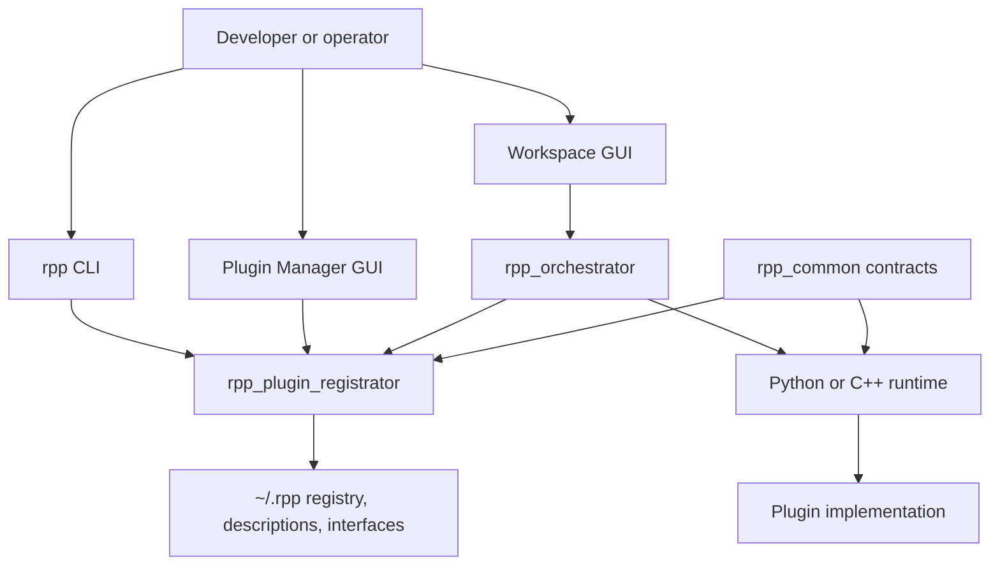

# System architecture

RPP separates **discovery**, **composition**, and **execution**. The
repositories are independent, but they share a small set of contracts and a
common registry/home directory.

## Design goals

## Layers

### Contracts: `rpp_common`

Common plugin types, message/data definitions, and plugin description models
define what an implementation must provide.

### Discovery and registration: `rpp_plugin_registrator`

The registrator parses plugin and plugin-type source, validates it, stores
descriptions, registers libraries and plugins, and generates language-specific
interfaces. Its default state is under `~/.rpp`.

### Composition: `rpp_orchestrator`

The orchestrator creates workspaces, stores component records and parameters,
assigns subcomponents, manages scripts, and exposes the workspace GUI. A
workspace is identified by its `.rppws` directory.

### Execution: `rpp_py` and `rpp_cpp`

The runtime loads a registered implementation, creates the plugin instance,
and connects it to the generated adapter/interface for its plugin type. Python
loads source modules directly; C++ builds a shared runtime and component
server.

### Integration and verification: `rpp_cli` and `rpp_testing`

`rpp_cli` presents the common operations as commands. `rpp_testing` supplies
fixtures, test plugins, test libraries, and mock workspaces so the other layers
can be tested without application-specific repositories.

## Runtime data flow

1. A plugin type is defined in a contract source file.
2. A plugin implementation is described and validated.
3. The library manager records the plugin and its source in the registry.
4. An interface is generated for the target language when the runtime needs one.
5. A workspace component references the registered plugin by name.
6. The Python or C++ runtime resolves the library path, loads the implementation, and creates the instance.
7. The component server executes the instance and exchanges typed data through the generated adapter and transport.

The registry is metadata, not the implementation itself. Source files remain in
libraries; workspace records refer to registered plugin identities.