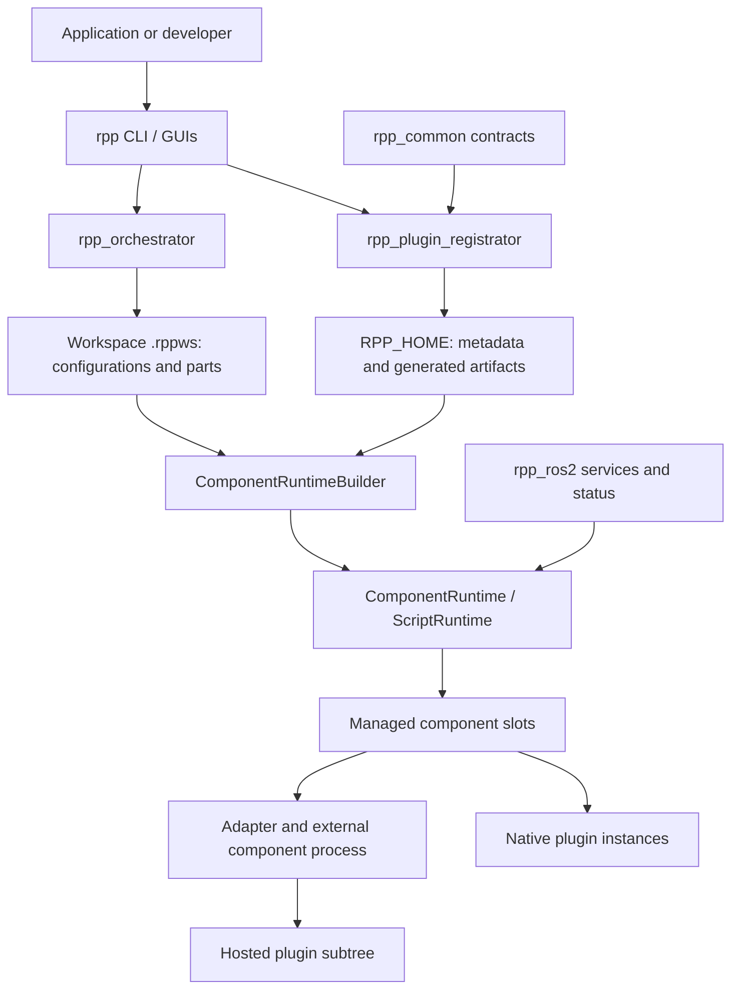

# System architecture

RPP separates contracts, registration, composition, and managed execution.
Independent repositories share generated interfaces and a configurable registry
home. Libraries own source, the home owns registration/generated artifacts,
and workspaces own saved [component][glossary-component] configuration and script assignments.

## Responsibilities

| Layer | Owner | Responsibility |
| --- | --- | --- |
| Contracts | `rpp_common` | Schemas, data models, parameter declarations |
| Registration | `rpp_plugin_registrator` | Library discovery, descriptions, validation, generated interfaces/adapters |
| Composition | `rpp_orchestrator` | Saved [components][glossary-component], parameters, script configurations, workspace GUI |
| Execution | `rpp_py`, `rpp_cpp` | Runtime construction, slot lifecycle, native loading and external hosts |
| Commands | `rpp_cli` | Registry/library/workspace commands and GUI launchers |
| ROS integration | `rpp_ros2` | Per-slot service commands and status snapshots over ROS 2 |
| Examples and measurements | `rpp_demos` | Runnable tutorial and benchmark sources |
| Verification support | `rpp_testing` | Shared fixtures, example [plugins][glossary-plugin] and mock workspaces |

## From source to a running component

1. Define an annotated Cap'n Proto [plugin type][glossary-plugin-type] inside a library.
2. Implement it in Python or C++ and declare its sources in `plugins.json`.
3. Register the library to validate metadata and generate language artifacts.
4. Create a saved workspace [component][glossary-component] with parameters and subcomponent assignments.
5. Build a runtime from the saved component or a script configuration.
6. Configure resources, then activate the desired native components explicitly.
7. Call the [plugin][glossary-plugin] contract from the application's own loop and close the runtime
   deterministically when done.

A component root has a fixed owning slot. A script directly owns its slot
collection and has no plugin instance. Slot managers validate transitions and
administer membership. Applications use runtime handles; plugins receive
contexts for services and child access. Composite plugins decide how ordinary
activation/deactivation propagates to their children; full shutdown stops
remaining descendants explicitly.

Purely native trees need no RPC infrastructure. Foreign-language boundaries
create adapter roots hosted by external processes, each owning its subtree.
Remote configure/cleanup is supported; adapted activation/deactivation and typed
handover remain pending. See [runtime lifecycle](runtime-lifecycle.md) and
[connections](component_connection.md) for current boundaries.

The ROS helper calls public runtime operations and preserves slot permissions.
It does not replace application ownership of root configuration, lifecycle safe
points, or shutdown. RPP component states are distinct from ROS node lifecycle.

[glossary-plugin-type]: https://github.com/coe-marble/rpp_docs/blob/develop/docs/glossary.md#plugin-type "Plugin Type: a language-neutral contract implemented by plugins."
[glossary-plugin]: https://github.com/coe-marble/rpp_docs/blob/develop/docs/glossary.md#plugin "Plugin: a concrete implementation of a Plugin Type."
[glossary-component]: https://github.com/coe-marble/rpp_docs/blob/develop/docs/glossary.md#component "Component: a saved plugin configuration with parameters and optional subcomponents."
