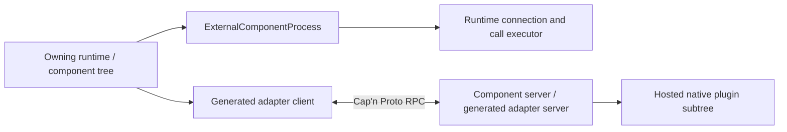

# Component connections

RPP uses generated [plugin-type][glossary-plugin-type] interfaces for native and adapted calls. Native
[components][glossary-component] load directly in their language runtime. Foreign-language components
run in a component-server process and communicate through Cap'n Proto RPC.
A purely native tree creates no RPC executor or external process.

Applications build [runtime handles](runtime-lifecycle.md); [plugins][glossary-plugin] receive a
`ComponentContext`. Use the context's subcomponent APIs rather than the removed
`ComponentContextBuilder` and `get_component()` examples.

## Calling components

For Python, access a named child's public view and instance:

```python
child = runtime.get_context().get_subcomponent_context("processors", "primary")
processor = child.get_instance()
result = processor.process(3.0)
```

For native-only instance enumeration, Python also provides
`get_subcomponent_instance()` and `enumerate_subcomponent_instances()`.
These reject adapted children; a child view's `get_instance()` can expose its
adapter. C++ uses `get_subcomponent<Type>(slot, name)` for typed access.
List slots require the component name; single/optional slots can select their
current entry when it is omitted.

Generated adapter methods expose synchronous calls. Python adapter clients also
provide `*_async` variants for use from asyncio:

```python
result = await processor.process_async(3.0)
```

Independent adapter calls can be awaited with `asyncio.gather`. These asynchronous
methods belong to generated adapters; do not assume every native implementation
provides them. Keep guards and runtimes alive until awaited work completes.
Use [guarded access](runtime-lifecycle.md#access-identity-and-guarded-calls) when
calls may overlap lifecycle or membership changes.

## External process ownership



At the first foreign-language child, construction creates an adapter boundary
and stops local descendant traversal. The external host constructs and owns
that child's complete subtree. It can recursively start another language host
for its own foreign descendants.

`ExternalComponentProcessRegistry` maps languages to server commands. Builders
allow custom commands through `register_external_component_server()`. A process
owns its subprocess, transport connection, adapter connections, and call executor;
a connection alone does not own the component tree or subprocess. Shared hosts
stay alive until their final owning runtime releases them.

`ComponentCallExecutor` provides a dedicated transport event loop. Synchronous
adapter methods submit request/send/wait work to that executor and return the
result to the caller. This keeps a component server's event loop available for
responses to nested calls. Do not synchronously call through the executor from
its own worker thread. C++ low-level `executor.call(lambda)` schedules work on
its KJ loop and waits for its result; it is not a nonblocking application future.

The component servers expose the shared `PluginRuntime` wire interface. C++'s
control endpoint is implemented by `RpcControlService`/`RpcControlClient`,
separately from application runtime ownership. Construction prepares transports
and starts servers with unconfigured roots; it does not activate plugins.

## Lifecycle across the boundary

Configure, activate, deactivate, and cleanup commands run in the hosting process
and return their result to the caller. Activation can carry the handover state
declared by the plugin type. The generated adapter encodes that value with its
schema ID; the host decodes it before calling the plugin.

The application prepares handover state before activation, switching, or reload.
See [typed handover](runtime-lifecycle.md#typed-handover) for the request format.
Keep generated clients, servers, and their runtimes on matching protocol versions.

## C++ RPC result lifetime

Generated C++ results retain their original response through shared ownership.
Struct, list, and Data views, including nested views and `Const::shallow_copy()`,
share that owner. Retaining a response moves its handle without cloning its
payload; scalar results remain ordinary values.

Release every returned view before closing its runtime, client context, or
executor. Executor-managed views may be released on the application thread;
final destruction is queued onto the existing RPC worker. Direct clients without
an executor release views on their original RPC thread before closing that
thread's event loop. Converting a view to a raw Cap'n Proto reader does not
transfer ownership; retain the RPP view while using that reader.

Regenerate affected wrappers/adapters and rebuild dependent C++ code to acquire
these lifetime rules. Older generated code retains its previous behavior.

## Shutdown

Explicitly close the runtime and check the lifecycle result. Owned adapter
capabilities must be released before their transport event loop is destroyed.
External-process shutdown requests remote shutdown and releases connections
before stopping the executor, then waits for the server before terminating it
if needed. Each server owns cleanup of its descendants.

See [C++ construction and ownership](cpp-context-flow.md) and
[registry compatibility](registry.md#generated-code-compatibility) for details.

[glossary-plugin-type]: glossary.md#plugin-type "Plugin Type: a language-neutral contract implemented by plugins."
[glossary-plugin]: glossary.md#plugin "Plugin: a concrete implementation of a Plugin Type."
[glossary-component]: glossary.md#component "Component: a saved plugin configuration with parameters and optional subcomponents."
