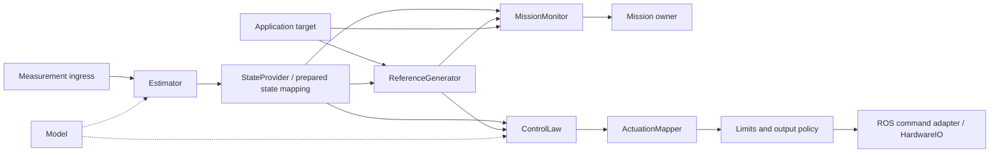

# Component boundaries

Each configured plugin declares its own layouts through `getDesc()`.
The application prepares compatible routes and executes components through
RPP lifecycle and guarded calls. The shared interfaces do not create another
plugin loader or lifecycle system.

## Responsibilities

| Component | Owns | Produces |
| --- | --- | --- |
| StateProvider | One buffered measured-state sample and its acquisition time. | A coherent state snapshot; no filtering or ROS subscriptions. |
| ReferenceGenerator | Accepted targets and reference sampling/progression. | Desired values; no arrival decision or actuator commands. |
| MissionMonitor | Progress/watchdog history and mission acceptance policy. | A continuation vote; a selected goal-capable monitor also decides arrival. |
| ControlLaw | Feedback/optimization policy and controller auxiliary history. | Controller-space control values. |
| ActuationMapper | Conversion/allocation and mapper auxiliary history. | Actuator values and estimated realized control. |
| ControlConstraint | A controller's mathematical feasible set. | Bounds, constraint values, and derivatives. |
| Model | Mathematical functions and prepared workspaces. | Predictions, observations, coordinate operations, and optional derivatives. |
| Estimator | Posterior state, covariance, and bounded processing history. | A timestamped filtered estimate. |
| Hardware / HardwareIO | Physical backend, measurements, command acknowledgement, and stop behavior. | Acquired values and accepted actuator commands. |

The [method reference](interface-methods.md) defines the calls; the
[shared layout guide](shared-bind-and-runtime.md) defines numeric packing.

## Data flow

This shows compatible roles, not a mandatory process topology. The current
control ROS node publishes actuator commands; hardware or simulation adapters
consume them. A `HardwareIO` contract does not mean the control node has already
integrated every physical driver.

## Model

A model evaluates explicit candidate state and input. It receives no desired
reference, owns no posterior estimate, and performs no physical actuation.
A filter compares its predicted observation with a measurement. A controller
compares predictions or measured state with its desired reference and owns the
tracking policy. Their workspaces and mutable state remain independent.

## Reference generation and mission supervision

The generator accepts points, paths, or trajectories according to
`getDesc().features`. Path pruning belongs to the generator; controller-specific
lookahead and command calculation belong to the controller.

Every active mission monitor participates in `isOk`. A false vote or evaluation
failure stops mission continuation. The task selects exactly one goal-capable
monitor for `isGoalReached`; that monitor also retains its veto.
Monitors receive current references and, when selected, a final target. They do
not accept or regenerate paths. See [control supervision](control/control-stack-and-message-map.md#mission-supervision).

## Configuration and execution

Configuration resolves field names, quantities, frames, resources, required
features, and destination ownership. It calculates numeric indices and allocates
buffers. Ordinary numeric execution uses those prepared routes.

Generator feature bits belong to `reference/constants.capnp`, model features
to `model/constants.capnp`, hardware stop modes to `hardware/constants.capnp`,
and shared status codes to `common/constants.capnp`. Mission decisions use
booleans plus status, rather than a generator completion/progress enum.

For current implementations and remaining integration work, see
[implementation status](../status.md).
