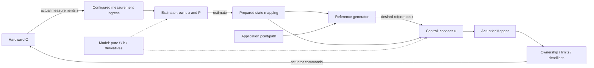

# Reference, control, model, estimator and hardware boundaries

Experimental interface proposal, 2026-11-21. Each family depends on common
numeric descriptors. RPP owns component resolution, lifecycle, configuration,
active guards and scheduling. These schemas are contracts; implementations and
native output-buffer bindings remain work to do.

## Five responsibilities

| Family | Owns | Runtime inputs | Runtime outputs |
| --- | --- | --- | --- |
| Reference generator | Accepted point/path/trajectory, sampling and reference progression | Current state, sample time and staged target | Desired reference buffers and generation completion |
| Control | Feedback/optimization policy, tracking residuals, weights, constraints and actuation mapping | Estimated state, desired references and a valid previous realized input | Requested model input, then mapped actuator command |
| Model | Mathematical prediction, observed quantities, derivatives and coordinate operations | Explicit trial state, input and time | Predicted state, predicted observations, derivatives or optional inverse dynamics |
| Estimator | Estimated state, covariance and measurement-processing history | Known inputs, process covariance, measured observations and measurement covariance | Filtered state and covariance at a declared reference time |
| Hardware | Physical connection, acquisition, command acknowledgement and device stop behavior | Actuator commands or stop requests | Actual measurements, acquisition times and accepted actuator commands |

A model does not receive target references, compute tracking objectives, own a
posterior estimate or write hardware. It evaluates numerical functions. Control
compares predicted/measured values with desired references. Estimation compares
predicted observations with actual measurements. They reuse the same physical
model definitions and coordinate operations while keeping their own state and
workspaces.

## Constants and exact consumers

| Constants | File | Field/method accepting them |
| --- | --- | --- |
| `task*` | Removed | The redundant reference-task kind/layout layer was removed. Common StateDesc already describes each reference vector's fields, quantities, frames and coordinate representations. |
| `generatorSetPoint`, `generatorSetPath`, `generatorSetTrajectory` | reference/constants.capnp | ReferenceGenerator.featuresDesc().features: independent bits enabling setPoint, setPath and setTrajectory. |
| `modelPredict`, `modelLinearize` | model/constants.capnp | Model.featuresDesc().features: capability bits for predict and linearize. |
| `modelObserve`, `modelObservationJacobian` | model/constants.capnp | Same feature mask: capability bits for observe and observationJacobian. These replace the old modelError/modelErrorJacobian names. |
| `modelInverseDynamics` | model/constants.capnp | Same feature mask: optional inverseDynamics support. |
| `progress*` | reference/constants.capnp | ReferenceMonitor.check().progress. |
| `stop*` | hardware/constants.capnp | HardwareIO.stop().mode. |
| `code*` | common/constants.capnp | UInt8 status results across all families. |

A feature mask is an OR of its family's capability bits. Generator setters are
independent: a point-only implementation need not accept paths or trajectories.
An unsupported setter returns codeUnsupported without changing the active target.
Configuration checks required generator/model features before activation.
For models, linearization implies
prediction; observation Jacobians imply observation. Retraction/difference are
state-coordinate operations, and observationDifference supports bound observed
spaces when observation is available. Unsupported optional operations return
codeUnsupported; they are not discovered for the first time during actuation.

Progress distinguishes running, measured arrival and detected failure. The unused
progressCanceled constant has been removed: cancellation belongs to the reference
execution supervisor. ReferenceGenerator.cancel() returns acceptance status; a
canceled generator returns codeNotReady. The supervisor knows the cancellation
reason. ReferenceMonitor.check() has no cancellation input and therefore is not
asked to infer cancellation from missing samples.

Stop modes request a configured physical policy, controlled stop, hold or disable.
Support and physical meaning are driver-specific and validated in configuration.
These are device operations, not RPP lifecycle state values. Stopping completion
requires feedback; zero effort or position is not a universal stopping command.

## Binding phase

All descriptions and Desc getters are used only in binding. Shared StateDesc
declares ordered fields, kinds, vector sizes, units and frame names. The shared
layout builder derives stored/tangent sizes and offsets; those are not authored
schema fields. ChannelDesc provides
scalar input/output meaning and physical resource identity where applicable.
Each reference and observed vector is described by the same common StateDesc.
There are no ControlLayoutDesc, ReferenceTaskDesc or ReferenceLayoutDesc wrappers.

RPP configures typed model slots in control/estimator implementations. Those
slots are not component-valued schema arguments. The coordinator binds numerical
shapes and explicit field/port mappings, then prepares native or CasADi functions
and output buffers. A producer and consumer may have different state layouts;
the mapping is prepared and validated once rather than guessed from values.

ReferenceGenerator.bind() takes the input StateDesc, target StateDesc, output
StateDesc list and fixed sampling offsets. Each output is one reference port.
ControlLaw.bind() takes state, reference-port descriptions and command channels.
Model.stateDesc()/inputsDesc() declare its mathematical state/input spaces, and
Model.bind() accepts a list of requested observed-space descriptions. They describe
actual quantities to calculate, independent of whether a consumer later uses them
as observations or control objectives. Estimator.bind() uses those same common
state/input/observation descriptions. Hardware endpoints describe their available
channels and static limits during the binding phase.

## Active calls

All numeric vectors and matrices are flat List(Float64). Multiple ports use
List(List(Float64)). Matrix shapes, strides, capacities and field mappings remain
fixed in the prepared binding. Status, completion and exact time fields retain
UInt8, Bool and integer representations. No names, descriptors, graph payloads
or growing collections travel through numeric updates.

### Reference

Target setters are bounded staging operations outside the numeric update.
sample(state,time) fills the assigned output buffers. Each output has
H * the output's derived stored width values, with horizon rows stored consecutively. Completion
means generation reached the endpoint, not that the robot measured at the goal.
One generator may fill several slots; different generators write disjoint slots.
Common Pose2D/Pose3D/Command types can be reused for cold target submissions.
Weights, selected error axes and objective priorities are controller parameters.
ReferenceMonitor.check() reads only the current row of each reference port using
borrowed row-zero views; horizon rows remain inputs to ControlLaw.compute().

### Control

ControlLawDesc declares flat state, reference, and control field lists for one
configured plugin instance. The manager prepares compatible field routes and
validates exclusive control destinations. Cascades own the routing and call order
of their children. Other controller implementations can run alongside them.

compute(state,reference,enabledAxes,inputValid,previousControl,previousControlValid,time,dt)
produces a flat control vector. horizonLength = 0 supplies current references.
Positive H uses H shared offsets or R * H per-scalar offsets. Values use
reference-major order r * H + h. inputValid follows those same scalar indices.
enabledAxes is empty (all enabled) or contains one flag per control scalar.
Disabled axes output zero and clear their history while layouts stay fixed.
previousControl reports the prior applied-control estimate after actuator limits
or a selected downstream reference inside a cascade. Its validity flag determines
whether the controller can use that history.

The law owns tracking error, costs and optimization decisions. It can request
model prediction/observations and derivatives, but the model receives no desired
reference. Geometry-specific residuals use shared coordinate operations; the
model's observationDifference supplies the intrinsic difference for its observed
space. The controller chooses argument order and weights. Jacobians of a tracking
residual must account for that difference operation; an observation Jacobian is
not generally the complete residual Jacobian for rotations far from the target.

ActuationMapper and ControlConstraint are control-family helper contracts.
The mapper performs bounded forwarding, allocation, kinematics or transmission
mapping. The constraint supplies lower/upper bounds, evaluated values and
Jacobians for a controller's feasible set. They may reuse mathematical models;
neither helper estimates the robot or acquires sensor packets.

### Model

predict(x,u,startTime,dt,inputDt) writes the next explicit state. linearize returns
A[nt*nt] and B[nt*nu], where nt is the derived state tangent width and nu is input count.
These derivatives use the same discrete prediction and actuation as execution.
The model is pure with respect to the simulated/estimated physical state; internal
parameters and prepared workspaces do not become a second mutable robot state.

observe(x,u,port,time,inputDt) returns a predicted physical quantity such as a tool
pose, joint positions, angular velocity or force. Its stored width is that
observation's derived stored width. observationDifference(port,origin,target) returns a
local difference of its derived tangent width. observationJacobian returns
Jx[ne*nt] and Ju[ne*nu], differentiating the local change in the observation at the
current predicted value; ne is that observation's derived tangent width. It does not subtract a
desired reference. Estimator innovations and control residuals use the operation
with their appropriate argument order.

inverseDynamics is optional. bind() reports its acceleration/effort width, or zero
when unsupported. Input-space slew history belongs in explicit state where it
affects prediction. Models can be native analytical or CasADi-backed; graph
construction, derivatives and compilation happen before active execution.

### Estimator

initialize/reset establish state, covariance and reference time outside active
processing. predict() accepts known model inputs, an already discretized process
covariance Q and the requested next reference time/duration. It invokes the
configured process model, advances the estimate and propagates covariance.
inputDtNs supplies the known input's slew interval separately from integration
duration, using the same model convention as control prediction.
The duration must match the requested advance from the previous reference time;
Model.predict receives the previous reference time as its stage start time.

correct(port,z,R,acquisitionTime) uses the configured observation model and its
innovation convention. Port bindings map the global measurement index to its
prepared model instance/output. estimate() writes x, P and their reference time.
P and Q have nt*nt entries; R has ne*ne entries for that observation's tangent
space. Process-noise discretization must match the selected prediction step.
This initial contract describes additive discrete noise; more advanced noise
augmentation is a future extension.

The estimator owns state/covariance/history. Models do not own the posterior and
references do not enter correction. Gating, late-data rejection/replay and history
bounds are explicit policy. Generic EKF/UKF implementations remain native and
CasADi optional in their mathematical model providers. Initial implementation
can preserve Euclidean/angle localization15 behavior; quaternion/error-state
filters additionally require explicit covariance transport/reset operations and
must not be claimed supported merely because a descriptor contains a quaternion.
Replay that splits a prior prediction interval needs reproducible noise
discretization for the new intervals. A forward-only generic implementation may
reject such late input; the legacy localization compatibility path must retain
its existing bounded replay behavior before replacing that implementation.

### Hardware

read() fills actual numeric measurements with acquisition time. write() reports
accepted actuator values; unknown acceptance is failure. Drivers can calibrate
and convert device values but do not implement the application's localization
filter or controller policy. A device backend owns the wire and its physical
watchdog. Exported typed RPP subcomponents share it. Generic image/scan/Data sensor
contracts and external publication remain deferred work.

## Schema locations

| Family | Schema files |
| --- | --- |
| Common | [descriptions](https://github.com/coe-marble/rpp_interfaces/blob/develop/plugin_types/common/descriptions.capnp), [constants](https://github.com/coe-marble/rpp_interfaces/blob/develop/plugin_types/common/constants.capnp), [execution policy](https://github.com/coe-marble/rpp_interfaces/blob/develop/plugin_types/common/execution.capnp) |
| Reference | [generator and monitor](https://github.com/coe-marble/rpp_interfaces/blob/develop/plugin_types/reference/reference.capnp), [progress constants](https://github.com/coe-marble/rpp_interfaces/blob/develop/plugin_types/reference/constants.capnp) |
| Control | [law and mapper](https://github.com/coe-marble/rpp_interfaces/blob/develop/plugin_types/control/control_law.capnp), [constraints](https://github.com/coe-marble/rpp_interfaces/blob/develop/plugin_types/control/constraints.capnp) |
| Model | [numeric model](https://github.com/coe-marble/rpp_interfaces/blob/develop/plugin_types/model/model.capnp), [capability constants](https://github.com/coe-marble/rpp_interfaces/blob/develop/plugin_types/model/constants.capnp) |
| Estimation | [estimator](https://github.com/coe-marble/rpp_interfaces/blob/develop/plugin_types/estimation/estimator.capnp) |
| Hardware | [hardware I/O](https://github.com/coe-marble/rpp_interfaces/blob/develop/plugin_types/hardware/hardware_io.capnp), [stop constants](https://github.com/coe-marble/rpp_interfaces/blob/develop/plugin_types/hardware/constants.capnp) |

The [method reference](interface-methods.md) documents when to use every method
and the meaning of every argument. The [shared route](shared-bind-and-runtime.md)
supplies the derived-layout and frame policy.
The [$realtime annotation](https://github.com/coe-marble/rpp_interfaces/blob/develop/plugin_types/common/execution.capnp) marks the planned
native view/output convention only; the current runtime does not implement it.
Existing owning wrappers and active-guard allocations still require shared runtime
work before claiming allocation-free execution. No realtime claim follows from
flat buffers or annotation syntax alone.
