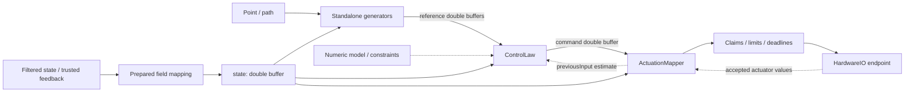

# RPP control stack and message map

Experimental control contract, 2026-11-21. The [shared binding/runtime route](../shared-bind-and-runtime.md)
defines reusable descriptions, flat buffers and the schematic across estimation,
localization, models and control. The [framework plan](ros-independent-control-framework.md)
defines implementation packages and dependencies.

The generic descriptions are in rpp_interfaces/common. Reference, model,
estimation, control and hardware files define separate numeric plugin families,
as described in the [boundary contract](../component-boundaries.md). All descriptor
use, including Desc getters, belongs to the binding phase. Active payloads use
List(Float64), fixed lists of those buffers and exact scalar time/status fields.
These experimental signatures require regeneration and native binding work;
registered legacy interfaces remain unchanged.

## Control loop

Runtime constructs one coherent control state from configured producers. Filtered
base state can come from localization and joint state from a separate filter or
trusted hardware. Each field has one producer. The loop consumes bounded-age,
frame/clock-compatible snapshots without blocking on external communication.
Hardware acquisition and command writing share the physical driver's backend.

## Direct description binding

ControlLaw.bind() receives the common StateDesc, reference descriptions and
command ChannelDesc list directly. Reference generators and monitors receive
the common StateDesc. Mappers and constraints receive StateDesc plus their
required command/actuator descriptions. There is no control-specific wrapper
around the shared state description.

StateDesc declares ordered fields, quantities, units and frame names. Binding
derives state offsets and stored/tangent dimensions from kind and vector size.
Command descriptors establish nu controller inputs. A robot
model's stateDesc()/inputsDesc() provide its mathematical state/input descriptions.
Robot-specific q/v/auxiliary mappings belong to that model's implementation and
RPP parameters; the generic control layer does not impose that classification
or a formula relating state and tangent dimensions.

Geometry, mounts, inertia, calibration and actuation history come from shared
RPP/MORE configuration. The adapter supplies numerical behavior using those
definitions rather than implementing independent physics.

## Reference binding and packing

Every reference port and target uses common StateDesc. There is no task-kind
constant or separate task/layout message. StateDesc.fields declares the desired
values, quantities, coordinate kinds, frames and row packing. The controller's
RPP configuration selects observed quantities, active error axes, weights and
priorities. Those are control objectives rather than model physics or generator
policy.

A port contains H * its derived stored width doubles, row-major. H and the time offsets
are cached during binding. The observed coordinate-space tangent width determines
residual width. Joint coordinates are named/bound fields; pose fields use the
shared planar/spatial/quaternion packing and frame conventions. A generator may
have input and output descriptions that differ, for example IK reference generation.

A generator's bind() receives a target layout and nonempty output-layout list.
Local output i follows outputs[i]. Runtime maps these outputs to disjoint writer
slots in the shared reference-buffer list. One generator can fill several slots;
several independent generators can fill the same configured list in another
composition. Indexed native output views avoid assembling new messages each tick.

featuresDesc() returns a UInt8 mask of generatorSetPoint, generatorSetPath and
generatorSetTrajectory. Check it during binding and expose only supported goal
operations. An unsupported setter returns codeUnsupported and preserves the target.
Target setters run outside the update with bounded staging. The newest accepted
target becomes active at the next sample; rejection preserves the prior target.
Planar/spatial targets reuse common Pose2D/Pose3D and vector targets reuse common
Command. Input and output layouts can differ for interpolation or kinematics.
Paths are ordered and nonempty; trajectory point/time counts agree, start at zero
and strictly increase. Target time zero is its first sample after acceptance.

The bound sampling offsets are nonempty, start at zero and strictly increase.
Row k represents timeNs+offsets[k], with checked arithmetic. A pass-through point
generator repeats its target; a profile generator can approach it over time.
Samples at/after a trajectory end repeat the exact final reference.
finished applies to the complete generator output group and becomes true when
the current sample reaches its end. Future rows reaching the endpoint earlier
do not finish the generator. A pass-through point finishes immediately; a profile
finishes at its generated endpoint. After cancellation takes effect, sample()
returns codeNotReady until another target is accepted. Runtime forwards the
group completion flag to each produced port for monitoring.

## Numeric update calls

| Call | Input/output buffers and exact scalar metadata |
| --- | --- |
| HardwareIO.read | Measurement doubles; acquisition time and UInt8 status. |
| ReferenceGenerator.sample | State doubles and time; reference double buffers, Bool completion and status. |
| ControlLaw.compute | State, interface input blocks, enabledAxes, inputValid, previousInput, previousInputValid, time and dt; command doubles and status. |
| ActuationMapper.commandMap | State, command and dtNs; actuators, realizedEstimate and status. |
| HardwareIO.write | Actuator doubles; accepted actuator doubles and status. |
| ActuationMapper.feedbackMap | State and actuators; realized controller input and status. |
| ReferenceMonitor.check | State, row-zero views of the reference ports, per-port completion and time; UInt8 progress and status. |

Each vector's length is fixed by binding. command and previousInput have nu
values. previousInput reports feedback in command order from the previous
accepted actuation or the previous selected reference at a cascade boundary.
Ignore it when previousInputValid=false, including the first cycle.
Only codeOk/codeLimited authorize outputs; limited commands must be fully checked
and feasible. Ordinary invalid input returns status. Failures do not authorize
reusing a previous command and trigger the configured coordinated hold/stop policy.

Monitor arrival/progress uses measured state, configured tolerances and bounded
history. Reference completion alone is not measured goal success.

## Model, residual and constraint boundaries

The [Model contract](../component-boundaries.md#model) is shared with estimation.
It binds only common state/input/observation descriptions. It predicts explicit
state and observed physical quantities; it receives no target references.
Prediction/observation Jacobians differentiate that mathematics. Control computes
tracking residuals and their derivatives using model outputs and shared coordinate
operations. Observation Jacobians are not automatically tracking-error Jacobians.

ControlConstraint belongs to control. bind() fixes M rows. bounds() returns a flat
2*M array: M lower bounds followed by M upper bounds. evaluate() returns M values
with lower<=g(x,u,t)<=upper. Equal bounds express equality. Inactive rows use
infinite bounds without resizing; values and Jacobians remain finite. jacobian()
returns row-major Jx[M*nt] and Ju[M*nu], with nt equal to the derived state tangent width.
Fixed RPP row scales apply consistently to values, bounds and derivatives.
Cache constant bounds. Scene/contact data is staged and frozen for each solve,
with geometry work bounded independently of scene size. Constraint calculations
can reuse pure model functions without moving control policy into the model.

Model and constraint adapters may be native or CasADi-backed. Functions and
derivatives are prepared during binding. Sparse output needs a bound mapping
to the flat row-major result layout. See the [boundary contract](../component-boundaries.md)
for feature bits, observation geometry, model/estimator state ownership and noise.

## Mapping and hardware

ActuationMapper.getDesc() declares state, command, and actuator field lists plus
limits selecting actuator fields. commandMap() is a pure, bounded conversion:
forwarding, kinematics, allocation or transmission. Its actuator vector has the
declared hardware width and realizedEstimate vector has nu values.
Actuation/history state that affects prediction is explicit in the state vector. Prediction uses the
same mapping/calibration as execution and never writes hardware.

feedbackMap() converts actuator values into realized control. Use hardware
feedback when available; the current script supplies its limited actuator commands.
Unsupported feedback mapping sets previousInputValid=false rather than assuming identity. Composite mapping
partitions actuator outputs; it does not run separate base/arm feedback laws
that replace a jointly optimized command.

HardwareIO description getters are called only in the binding phase. Measurement
and command descriptions fix each scalar's order, meaning and units. Static
limitsDesc() reuses common FloatMatrix with three rows: lower, upper and maximum
absolute rate per second. Infinite bounds/rates disable that limit. Reject NaN,
negative rates and lower greater than upper. No static matrix object is passed
through an active numeric call.

write() reports clipping as codeLimited with actual accepted values. Unknown
acceptance is failure. Partial writes fault the coordinated group; separate
drivers have no implied atomic physical write. stop() receives prepared command
channel indices and a UInt8 mode, handles all modes of each physical resource
together, and uses configured physical behavior. Stop completion requires
feedback; zero effort/position is not a universal stop. Preserve monotonic
watchdogs while application time is paused and retain physical/rate limits.

Hardware is the common physical-driver category. interfacesDesc() summarizes
exported typed RPP subcomponents by name and schema identity. RPP contexts resolve
those endpoints; there is no component-returning getInterface schema method.
Active handles guard execution and device shutdown drains endpoint calls before
closing the shared backend. Current HardwareIO remains scalar; generic sensor
Data/message-type protocols are future work. Camera/lidar streams would expose
separate typed endpoints, with explicit sensor and publisher configuration.

## Lifecycle and implementation

RPP owns construction, parameters, lifecycle and replacement. Configuration and
binding resolve descriptions, handles, buffers and functions. Activation admits
updates after all required inputs are ready. Reconfiguration, compilation and
shape changes happen inactive. Numerical failure status does not automatically
change lifecycle state; the coordinator applies its fault policy. New interfaces
currently declare no handover payload, so activation initializes algorithm state.
Compatible handover can use RPP's existing lifecycle mechanism when declared.

Use get_subcomponent_context() for configured access and active handles for
execution. Direct get_instance<T>() does not supply a runtime guard or validate
its static cast. The parent SubcomponentContext is not a child context; use the
device runtime's own context or configured RPP bindings for its exported slots.

The realtime annotation now lives in common/execution.capnp. Numeric lists must
map to readonly borrowed views or mutable caller-owned output views. Scalar
results return by value. No per-update descriptor processing, serialization,
allocation, resizing, unbounded work or owning conversion is allowed by that
planned native policy. Existing wrapper/active-guard behavior still needs work;
these schemas do not constitute an implemented realtime execution guarantee.

The [method reference](../interface-methods.md) explains every method and argument.
The [shared route](../shared-bind-and-runtime.md) gives buffer ownership, dimension
examples and the next implementation steps. The [estimation proposal](../estimation/generic-estimation-and-localization.md)
defines the planned generic filter/localization split.

## Schema sources

| File | Responsibility |
| --- | --- |
| [common/constants.capnp](https://github.com/coe-marble/rpp_interfaces/blob/develop/plugin_types/common/constants.capnp) | Shared exact UInt8 constants. |
| [common/descriptions.capnp](https://github.com/coe-marble/rpp_interfaces/blob/develop/plugin_types/common/descriptions.capnp) | Generic state fields, dimensions and scalar channel descriptions. |
| [common/execution.capnp](https://github.com/coe-marble/rpp_interfaces/blob/develop/plugin_types/common/execution.capnp) | Native realtime annotation. |
| [reference/reference.capnp](https://github.com/coe-marble/rpp_interfaces/blob/develop/plugin_types/reference/reference.capnp) | Standalone generators, reference descriptions and monitoring. |
| [control_law.capnp](https://github.com/coe-marble/rpp_interfaces/blob/develop/plugin_types/control/control_law.capnp) | Law and actuation mapper. |
| [model/model.capnp](https://github.com/coe-marble/rpp_interfaces/blob/develop/plugin_types/model/model.capnp) | Reference-independent mathematical model. |
| [control/constraints.capnp](https://github.com/coe-marble/rpp_interfaces/blob/develop/plugin_types/control/constraints.capnp) | Control feasibility bounds and derivatives. |
| [estimation/estimator.capnp](https://github.com/coe-marble/rpp_interfaces/blob/develop/plugin_types/estimation/estimator.capnp) | Generic estimation lifecycle and numeric updates. |
| [hardware_io.capnp](https://github.com/coe-marble/rpp_interfaces/blob/develop/plugin_types/hardware/hardware_io.capnp) | Hardware export summary and scalar HardwareIO. |
