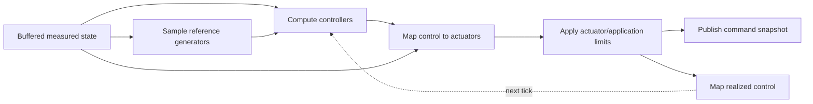

# Control execution

`ControlScript` turns measured state and desired references into actuator
commands. `ControlScriptNode` receives ROS measurements and goals, runs the
script on a worker, and publishes its results.

## A pose goal through a cascade

Consider a planar vehicle at x=0, y=0, yaw=0, with a target at x=2, y=0, yaw=0.
Its measured state includes pose and body velocity:

```text
state = [x, y, yaw, vx_body, vy_body, wz_body]
```

The reference generator stores the target. On each tick it samples the desired
pose according to its interpolation or path algorithm. This separates where
the vehicle should be from how the controller tries to get there.

The outer pose controller compares that sampled pose with measured pose and
produces desired body velocity. For example, if this tick's x reference is 2 m,
yaw is zero, and x proportional gain is 1 s⁻¹ with no I/D contribution or active
limit, the 2 m error produces a 2 m/s forward reference.

The inner velocity controller compares that desired velocity with measured
velocity. Its output is force and yaw moment. `WaterjetAllocator` converts the
requested wrench into normalized thrust and nozzle commands, using the
configured jet geometry and limits.

```text
pose target -> sampled pose -> desired velocity -> force/moment -> thrust/nozzle
               generator       pose controller    velocity PID   allocator
```

After limiting the actuator commands, the script maps them back to an estimate
of realized control. The next controller tick uses that feedback for
anti-windup: the controller can account for a requested force that the
actuator could not provide.

The cascade owns these internal connections. The script sees the cascade's
combined state/reference requirements and final control output.

## Components and routing

Each plugin declares flat layouts. The script resolves fields and prepares
state, current-reference, control, actuator, and realized-control routes.
Control and actuator destinations have exclusive writers. Controllers may
consume overlapping generated reference fields; the script warns about overlap.

For example, the state provider can expose all six planar state values while
the pose PID consumes only x/y/yaw and the velocity PID consumes vx/vy/wz.
Configuration matches field names, quantities, frames, and resources and saves
the gather indices. Ticks reuse those indices to supply each plugin's values.

Separately loaded top-level controllers do not acquire implicit connections.
A `CascadeController` owns its child routes, call order, and child lifecycle.
Other controller implementations can run alongside it.

A cascade's outermost controller can consume a reference horizon or a pruned
path representation. Inner controllers use current references. Path pruning
belongs to the reference generator; regulated-pure-pursuit lookahead and velocity
calculation belong to the outer controller.

## Control loop



`ControlScript::step(time_ns, dt_ns)` validates the incoming state and tick
arguments once, then runs prepared stages. Generated outputs and component
availability still require validation. Direct stage calls validate their own
inputs.

The mapper converts control to actuator values. After limits, `feedbackMap()`
estimates realized controller input for the next tick's anti-windup/history.
Controller and mapper auxiliary states remain separate during inspection and
handover.

## State and threading

`rpp_control::BufferedStateProvider` implements
`rpp_interfaces::StateProvider`. The ROS callback writes a complete measured
sample and acquisition time into it. The worker reads one coherent sample for
control. If localization supplies that sample, the provider stores the filtered
state exactly as received; filtering remains in localization.

The ROS executor converts measurements and goals, manages lifecycle changes,
and publishes snapshots. A dedicated worker performs numeric ticks with
prepared buffers. Scheduling uses a steady clock; measurement freshness,
numeric time, integration duration, and goal deadlines use the node's ROS clock.
Paused or backward simulation time prevents integration.

Management operations pause execution before changing routes, staging goals,
or rebinding horizons. Deactivating one component does not implicitly deactivate
its dependents: they remain active and report unavailable inputs. Compatible
replacement rebuilds affected routes.

## Goals and reference ownership

Script setters accept a generator instance name, compact target values, update
mask, and deadline. Paths/trajectories submit waypoint-major rows; the script
expands compact goals into the generator's reference order. False mask entries
preserve both the old curve and its deadline.

Goals belong to generator instances. A controller replacement retains surviving
generator goals and their original deadlines. Replacing a generator needs a new
goal. Expired references become invalid; expiry does not release output claims
or reference ownership.

The ROS adapter grants one identity token per reference interface through
`request_external_reference`. `release_external_reference` cancels that
interface's goals and releases ownership. There is no separate control token.
Disabling `~/enable` cancels goals and produces configured safe output while
preserving component lifecycle states and reference ownership.

For example, if client A claims an interface, client B cannot replace its goals
with a different token. If A stops refreshing its goal, the values expire but A
still owns the interface. A must release it before another client can claim it.
The plain `cmd_vel` override described below deliberately bypasses this check.

## Mission supervision

Reference sampling returns values and status, with no completion flag.
A sampled trajectory passing its final timestamp produces a throttled warning;
it does not establish measured arrival.

All active `MissionMonitor` instances evaluate `isOk`. Only
`ok=true, status=codeOk` permits continuation. A new mission resets monitoring
history; replanning preserves mission watchdogs.

FollowPath selects one goal-capable monitor through `goal_checker_id` or the
configured default. Only that monitor is asked for `isGoalReached`, after
every continuation check approves. Monitor messages explain vetoes/errors to
the action owner.

`~/mission_monitors` publishes active instances by name/ID with cached
evaluation results, the selected goal monitor, and diagnostic messages.
Its single stamp is evaluation time; unevaluated entries remain marked unknown.
Publication does not reevaluate plugins.

## ROS navigation interface

With `expose_navigation_topics=true`, `NavigationInterface` receives the
control node directly. Conversion stays on the executor, without internal
layout subscriptions or goal publishers.

Masked `pose_ext`, `twist_ext`, and `wrench_ext` commands use reference tokens.
`is_dev=true` bypasses goal-token/stamp checks and enables plain `cmd_pos`
and `cmd_wrench`. Plain stamped `cmd_vel` is exposed when `is_dev` or
`enable_nav2_cmd_vel` is true; the latter defaults to true.

`cmd_vel` is an authorized temporary velocity override, including when a token
already owns the interface. It does not claim ownership or abort FollowPath.
An active path keeps its progress and resumes its velocity references/selectors
when the override expires.

All navigation command types expire unless refreshed, including pose goals.
`navigation_reference_timeout_sec` defaults to 0.5 seconds. Numeric goal
deadlines remain enforced in development mode.

The `follow_path` action forwards the global path to `ReferenceGenerator.setPath`.
The adapter verifies path support at construction and on subsequent submissions.
`PlanarPathReference` prunes it; an outer
`RegulatedPurePursuitController2D` can compute velocity references for inner control.
Mission monitors supply guards and goal completion. Leave Nav2's
`progress_checker_id` and `path_handler_id` empty; the action rejects requests
that set them.

## Running and inspecting

After building the ROS package, sourcing the workspace, and registering its
plugins, start the bundled control script with development navigation inputs:

```bash
ros2 launch rpp_control control_script.launch.py \
  expose_navigation_topics:=true is_dev:=true
```

The default node name is `control_script`. In another sourced terminal, inspect
its advertised fields and enable execution:

```bash
ros2 topic echo /control_script/layout --once --qos-durability transient_local
ros2 service call /control_script/enable std_srvs/srv/SetBool "{data: true}"
ros2 topic echo /control_script/status
```

The layout gives the measurement/resource names, field order, goal interfaces,
and final actuator fields. Supply fresh state samples before expecting control
output; enabling alone does not supply a measured state or a goal. Namespaces
change these paths in the usual ROS way.

The [package runbook](https://github.com/coe-marble/rpp_control/blob/develop/README.md)
contains the numeric/masked goal message examples and controller parameters.
The Vizanti Layout Inspector displays layouts and their latest values.

Numeric failures select configured safe commands for affected branches;
an unrecoverable plugin exception stops the worker. The output adapter or driver
applies those commands to simulation or hardware and owns its physical watchdog.
