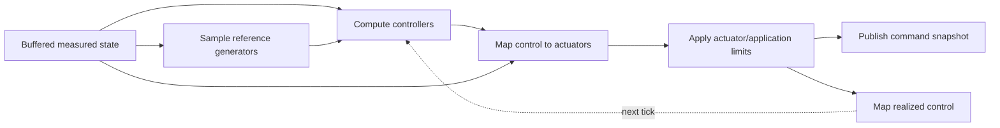

# Control execution

`rpp_control` implements the shared contracts with a ROS-independent
`ControlScript` and an optional `ControlScriptNode`.
Read [shared layouts](../shared-bind-and-runtime.md) for field and horizon
packing and the [method reference](../interface-methods.md) for plugin calls.
This page owns script-level composition and execution behavior.

## Components and routing

Each plugin declares flat layouts. The script resolves fields and prepares
state, current-reference, control, actuator, and realized-control routes.
Control and actuator destinations have exclusive writers. Controllers may
consume overlapping generated reference fields; the script warns about overlap.

Separately loaded top-level controllers do not acquire implicit connections.
A `CascadeController` owns its child routes, call order, and child lifecycle.
Other controller implementations can run alongside it.

A cascade's outermost controller can consume a reference horizon or a pruned
path representation. Inner controllers use current references. Path pruning
belongs to the reference generator; regulated-pure-pursuit lookahead and velocity
calculation belong to the outer controller.

## Control loop

`ControlScript::step(time_ns, dt_ns)` validates the incoming state and tick
arguments once, then runs prepared stages. Generated outputs and component
availability still require validation. Direct stage calls validate their own
inputs.

The mapper converts control to actuator values. After limits, `feedbackMap()`
estimates realized controller input for the next tick's anti-windup/history.
Controller and mapper auxiliary states remain separate during inspection and
handover.

## State and threading

`rpp_control::BufferedStateProvider` implements
`rpp_interfaces::StateProvider`. It buffers measurements; it does not estimate
state or create ROS subscriptions.

The ROS executor converts measurements and goals, manages lifecycle changes,
and publishes snapshots. A dedicated worker performs numeric ticks with
prepared buffers. Scheduling uses a steady clock; measurement freshness,
numeric time, integration duration, and goal deadlines use the node's ROS clock.
Paused or backward simulation time prevents integration.

Management operations pause execution before changing routes, staging goals,
or rebinding horizons. Deactivating one component does not implicitly deactivate
its dependents: they remain active and report unavailable inputs. Compatible
replacement rebuilds affected routes.

## Goals and reference ownership

Script setters accept a generator instance name, compact target values, update
mask, and deadline. Paths/trajectories submit waypoint-major rows; the script
expands compact goals into the generator's reference order. False mask entries
preserve both the old curve and its deadline.

Goals belong to generator instances. A controller replacement retains surviving
generator goals and their original deadlines. Replacing a generator needs a new
goal. Expired references become invalid; expiry does not release output claims
or reference ownership.

The ROS adapter grants one identity token per reference interface through
`request_external_reference`. `release_external_reference` cancels that
interface's goals and releases ownership. There is no separate control token.
Disabling `~/enable` cancels goals and produces configured safe output while
preserving component lifecycle states and reference ownership.

## Mission supervision

Reference sampling returns values and status, with no completion flag.
A sampled trajectory passing its final timestamp produces a throttled warning;
it does not establish measured arrival.

All active `MissionMonitor` instances evaluate `isOk`. Only
`ok=true, status=codeOk` permits continuation. A new mission resets monitoring
history; replanning preserves mission watchdogs.

FollowPath selects one goal-capable monitor through `goal_checker_id` or the
configured default. Only that monitor is asked for `isGoalReached`, after
every continuation check approves. Monitor messages explain vetoes/errors to
the action owner.

`~/mission_monitors` publishes active instances by name/ID with cached
evaluation results, the selected goal monitor, and diagnostic messages.
Its single stamp is evaluation time; unevaluated entries remain marked unknown.
Publication does not reevaluate plugins.

## ROS navigation interface

With `expose_navigation_topics=true`, `NavigationInterface` receives the
control node directly. Conversion stays on the executor, without internal
layout subscriptions or goal publishers.

Masked `pose_ext`, `twist_ext`, and `wrench_ext` commands use reference tokens.
`is_dev=true` bypasses goal-token/stamp checks and enables plain `cmd_pos`
and `cmd_wrench`. Plain stamped `cmd_vel` is exposed when `is_dev` or
`enable_nav2_cmd_vel` is true; the latter defaults to true.

`cmd_vel` is an authorized temporary velocity override, including when a token
already owns the interface. It does not claim ownership or abort FollowPath.
An active path keeps its progress and resumes its velocity references/selectors
when the override expires.

All navigation command types expire unless refreshed, including pose goals.
`navigation_reference_timeout_sec` defaults to 0.5 seconds. Numeric goal
deadlines remain enforced in development mode.

The `follow_path` action forwards the global path to `ReferenceGenerator.setPath`.
The adapter verifies path support at construction and on subsequent submissions.
`PlanarPathReference` prunes it; an outer
`RegulatedPurePursuitController2D` can compute velocity references for inner control.
Mission monitors supply guards and goal completion; Nav2's separate
`progress_checker_id` and `path_handler_id` are unsupported.

## Running and inspecting

Use the [package runbook](https://github.com/coe-marble/rpp_control/blob/develop/README.md)
for launch commands, numeric/masked ROS messages, parameter examples, and plugin
configuration. Read `~/layout` before sending numeric goals or state samples.
The Vizanti Layout Inspector can display those layouts and current values.

The [launch file](https://github.com/coe-marble/rpp_control/blob/develop/launch/control_script.launch.py)
defines startup options. Shared ROS messages live in
[`rpp_ros_interfaces`](https://github.com/coe-marble/rpp_ros_interfaces).
Numeric failures select configured safe commands for affected branches;
an unrecoverable plugin exception stops the worker. Physical stopping and
hardware watchdogs remain the responsibility of the selected output adapter/driver.
