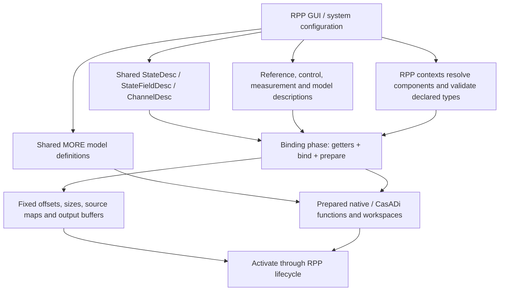
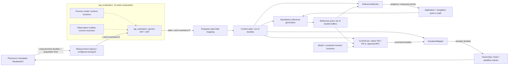

# Shared descriptors and numeric runtime

Planned route, 2026-11-21. Shared state and channel descriptions live in
rpp_interfaces/common. Control, estimation, localization and model adapters use
the same description vocabulary. Their active numeric calls pass flat
`List(Float64)` buffers, which represent lists of C++ doubles.

Descriptions are used only in the binding phase. That phase includes description
getters, connection validation, `bind()` and preparation of buffers/functions.
Descriptions never accompany active samples or get interpreted by an update.

The common schemas and flat control signatures are present in this draft.
Generic estimator and model contracts are also present; their implementations
and model-sharing integration remain planned work. This is an API-breaking revision of unregistered experimental contracts;
registered legacy control/localization interfaces are unchanged.

## Binding route



The coordinator establishes the full binding before admitting updates. It
resolves names, units, frames, matrix dimensions, algorithm capabilities and
resource ownership. Unknown or incompatible bindings fail configuration. The
prepared binding contains numeric ranges and handles, not repeated strings or
descriptor traversals. Reconfiguration happens inactive and rebuilds affected
bindings before activation.

## Runtime route



The diagrams show one logical system. Localization/transport may execute in a
different process or at a different rate. Completed estimates enter a bounded
cache outside the control tick. The tick reads a coherent snapshot that satisfies
configured age/skew and frame/clock rules. It does not wait for a network reply.
Direct trusted joint feedback can also enter the prepared state map without an
estimator. Each state field has one configured producer.

The shared MORE definitions feed process, observation, control and simulation
functions. Each consumer has its own state and scratch. Native core execution
and estimation have no required CasADi dependency; optional model/derivative
adapters and the MPC extension use CasADi.

## Shared schema ownership

| File | Binding-only definitions |
| --- | --- |
| [common/descriptions.capnp](https://github.com/coe-marble/rpp_interfaces/blob/develop/plugin_types/common/descriptions.capnp) | StateDesc, StateFieldDesc and ChannelDesc. |
| [common/constants.capnp](https://github.com/coe-marble/rpp_interfaces/blob/develop/plugin_types/common/constants.capnp) | Shared status, coordinate, unit, quantity and channel constants. |
| [common/execution.capnp](https://github.com/coe-marble/rpp_interfaces/blob/develop/plugin_types/common/execution.capnp) | Native realtime method annotation and its execution policy. |
| [reference/reference.capnp](https://github.com/coe-marble/rpp_interfaces/blob/develop/plugin_types/reference/reference.capnp) | Standalone generators bind shared target/output StateDesc directly. |

Estimation/localization bind the common StateDesc and ChannelDesc directly.
The controller also binds StateDesc directly, alongside reference and command
descriptions. Robot-specific q/v mappings remain inside the model plugin. Future
estimation-specific descriptions add covariance, measurement/model bindings and
algorithm options without duplicating generic fields or common geometry.

## State fields and dimensions

`StateDesc` contains only an ordered list of fields. Configuration never supplies
stored offsets, tangent offsets or total dimensions. A shared native layout
builder, still to be implemented, calculates these once during binding. It uses
the same rules for state, targets, reference ports and observations.

`StateFieldDesc.size` specifies vector width when the kind does not determine it.
For fixed-width kinds, zero means infer the width; an explicit size must match it.
It is a count of stored doubles, not a spatial dimension or repetition count.

| Kind from common/constants.capnp | Authored size | Stored width | Tangent width |
| --- | --- | --- | --- |
| coordinateEuclidean | N > 0 | N | N |
| coordinateContinuousAngle | 0 or 1 | 1 | 1 |
| coordinatePlanarPose | 0 or 3 | 3: x, y, yaw | 3: dx, dy, dYaw |
| coordinateSpatialPose | 0 or 7 | 7: x, y, z, qx, qy, qz, qw | 6: dx, dy, dz, dRx, dRy, dRz |
| coordinateSpherical | 0 or 4 | 4: qx, qy, qz, qw | 3: dRx, dRy, dRz |

Thus a two-dimensional position vector uses `kind: coordinateEuclidean, size: 2`.
A planar pose uses `kind: coordinatePlanarPose` without a size. A spatial pose
uses `kind: coordinateSpatialPose` without a size. Two poses are two named fields;
`size: 2` does not describe a spatial pose. A continuous revolute joint is one
continuous-angle field; bounded joint positions are Euclidean scalars.

The binding coordinator invokes the shared builder for each distinct description.
The builder visits fields in list order, computes each width, assigns consecutive
stored and tangent ranges and sums their totals, denoted `n` and `nt`. For example:

```yaml
fields:
  - {name: position, kind: coordinateEuclidean, size: 3, quantity: quantityPosition, unit: unitMetre, frameId: map, childFrameId: base_link}
  - {name: orientation, kind: coordinateSpherical, quantity: quantityPosition, unit: unitNone, frameId: map, childFrameId: base_link}
  - {name: velocity, kind: coordinateEuclidean, size: 3, quantity: quantityVelocity, unit: unitMetrePerSecond, frameId: base_link, childFrameId: base_link}
```

This is illustrative RPP configuration with constant names resolved to their UInt8
values, rather than a new YAML loader contract. The generated internal layout is:

| Field | Stored range | Tangent range |
| --- | --- | --- |
| position | [0, 3) | [0, 3) |
| orientation | [3, 7) | [3, 6) |
| velocity | [7, 10) | [6, 9) |

The state has `n=10` and `nt=9`, so its covariance has 81 entries. These ranges
belong to the prepared C++ binding; they are not additional Capn Proto messages.
All consumers must use the same builder rules. Duplicate field names, unknown
kinds, invalid sizes, integer overflow and incompatible connections fail binding.

Values are finite and quaternions are normalized in `[x,y,z,w]` order. Euclidean
increments add, and continuous-angle differences wrap into `[-pi,pi)`. Planar
pose increments add position in frameId axes and wrap yaw. Spatial pose increments
add position in frameId axes and left-multiply orientation by Exp(dR), whose
rotation-vector axes also follow frameId. Spherical fields use that same rotation
rule. Consequently, spatial pose difference is position subtraction followed by
Log(Rtarget * Rorigin^-1); it does not rotate the position around the frame origin.
These are product position/orientation coordinates, not a body-frame SE(3) twist.
At the rotation-log branch cut, use a deterministic principal-log rule. Covariance
and Jacobians use exactly these tangent coordinates.

Velocity, acceleration and auxiliary vectors use Euclidean storage. Split
mixed-unit vectors into fields with the corresponding units. Pose fields use
unitNone with metres/radians fixed by the packing above; spherical fields use
unitNone. Quantity and unit describe numeric meaning, independently of packing.

## Frames

Descriptors use ROS-style frame names as cold metadata, resolved to internal IDs
during binding. No frame strings or transforms accompany active numeric buffers.

- `frameId`: the coordinates in which this field's numbers are expressed.
- `childFrameId`: the body/frame being described; for a pose, the child whose pose
  is given in frameId. For spatial velocity/force, it identifies the subject and
  its origin. It does not select a different coordinate basis.

For a pose, `frameId: map, childFrameId: base_link` means the pose of base_link
in map, matching the roles in ROS
[TransformStamped](https://github.com/ros2/common_interfaces/blob/rolling/geometry_msgs/msg/TransformStamped.msg).
Vector components and local corrections always use their own field's frameId.
The independent expressedIn and relativeTo selectors have been removed.
Joint/actuator scalars can leave frame names empty. A geometric field requires a
known frameId; pose/orientation fields also require a known childFrameId.
Sensor/link mounting transforms and kinematics come from the configured robot
model. A frame name does not create a mounting transform.

There is a ROS Odometry detail at the wrapper boundary: its pose uses the header
frame and its twist uses the child frame, as specified in
[Odometry.msg](https://github.com/ros2/common_interfaces/blob/rolling/nav_msgs/msg/Odometry.msg).
An adapter therefore binds a pose field with `frameId=odom, childFrameId=base_link`
and body-velocity fields with `frameId=base_link, childFrameId=base_link`.
The latter means base velocity expressed in base axes, not velocity relative to
itself. The derivative reference, such as motion relative to odom, is part of the
bound model/source convention. It cannot be inferred from a vector's frame name.
Incompatible motion conventions must be rejected or explicitly converted at binding.

Use right-handed axes, body x forward/y left/z up, SI metres/radians/seconds and
fixed-axis rotation-vector covariance as described by
[REP-103](https://github.com/ros-infrastructure/rep/blob/master/rep-0103.rst).
Optical/NED frames remain explicitly named, transformed secondary frames.

`ChannelDesc` describes one scalar numeric channel. Coordinate/auxiliary channels
use zero-based `field` and stored `component` indices into their bound StateDesc.
Spatial channels use frameId for their axes, childFrameId for the subject/origin,
and component 0/1/2 for x/y/z within the declared linear/angular quantity.
Actuator channels use resource, quantity and unit. Unused numeric selectors are
zero; unused strings are empty. All command modes of one actuator share its
resource name. Binding validates selector applicability and units; labels do not
replace those semantic checks.

## Flat buffer conventions

| Buffer | Length and packing established in binding |
| --- | --- |
| State x | n doubles; n and stored ranges are calculated from the ordered fields. |
| State increment/error | nt doubles; nt is calculated from the field kinds. |
| Estimate covariance P | nt * nt doubles, row-major. |
| Measurement z | Measurement-channel count or the selected observation's bound width. |
| Measurement covariance R | ne * ne doubles, row-major; ne is the observation's derived tangent width. |
| Reference port i | H * width[i] doubles, row-major horizon samples. |
| Command u | Bound controller input width nu. |
| Actuator command | Bound HardwareIO command-channel count. |
| Matrix/Jacobian | Bound rows * columns doubles, row-major. |

Shapes are not transmitted or rediscovered during an update. H and the sampling
offsets are fixed by the bound horizon. Each reference port is a separate
`List(Float64)` inside `List(List(Float64))`. A generator can fill several ports,
and generators have disjoint writer assignments. The controller reads the same
prepared buffers without joining them into another message.

Scalars such as status, time, duration, readiness and completion retain their
proper UInt8/UInt64/Bool types. Timestamps, durations and relative offsets all
use unsigned 64-bit nanoseconds. Numeric buffer payloads contain only doubles.
Cold point/path submissions can still reuse common Pose2D/Pose3D/Command types;
static limit descriptions can reuse common FloatMatrix. None is a hot numeric
result wrapper. Shape changes require deactivation and rebinding.

## Localization and robot examples

A 15-state navigation model can describe 15 Euclidean/angle values and a tangent
size of 15. Its estimate is `x[15]`; covariance is `P[225]`. Additional filter
state dimensions, sensor ordering and state operations come from its bound
models rather than fixed generic-EKF indices.

A planar vehicle control buffer can be bound as:

```text
x = [x, y, yaw, vx_body, vy_body, wz_body]
     <--- pose ---> <------ velocity ------>
```

Its pose field derives stored/tangent widths 3/3. Velocity fields carry the correct
linear/angular units. Both stored and tangent state size are six. A six-joint
arm uses six joint-position and six joint-velocity scalars. A combined planar
base and arm has one bound 18-double control state before auxiliary values.

The localization-to-control map selects the base pose/velocity from the estimate
and combines it with joint feedback. It uses precomputed gather/scatter ranges;
it does not assume that the estimate and controller have identical layouts.
A bounded explicit copy is permitted where layouts differ. Compatible contiguous
inputs can be borrowed directly.

## Native C++ and real-time implementation route

RPP resolves configured components with get_subcomponent_context(), validates
registration/types and executes them through active handles. Descriptors and
Capn Proto serialization are not part of the numeric update. Native bindings
must expose readonly borrowed double views and mutable caller-owned output views.
Returning newly allocated std::vector objects each tick violates this policy.

The coordinator owns buffers and keeps them alive until all consumers finish.
Every speculative model/mapper call site has its own prepared outputs. Inputs
cannot alias writable outputs. Model preparation, differentiation, compilation,
allocation and graph construction happen in binding. Existing active-guard and
data-wrapper allocation behavior must also be addressed in the shared runtime.
No schema annotation or flat list alone proves allocation-free or hard-real-time
execution. Solvers, loops and I/O require finite work budgets.

## Planned implementation sequence

1. Use the shared common descriptors and flat control signatures in this draft.
2. Implement Model/Estimator bindings using the same common descriptors and
   extract the generic filter from the existing localization implementation.
3. Implement native view/output bindings and bounded control/estimation execution
   using RPP lifecycle and guarded component access.
4. Add the localization15 composition and explicit estimate-to-control source maps.
5. Reuse MORE graphs through prepared numeric adapters; add MPC and whole-body
   composition without implementing core scheduling or filtering in CasADi.
6. Add generic sensor Data/message-type payloads later; scalar command semantics
   remain unchanged.

The [five-family boundary contract](component-boundaries.md) identifies every
constant consumer and separates model mathematics from reference, control,
estimator and hardware ownership.
