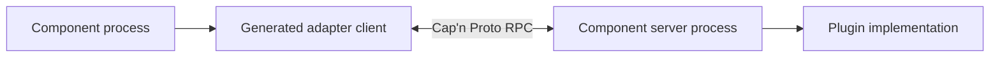

# Plugins, plugin types, and interfaces

A **[plugin type][glossary-plugin-type]** is the contract implemented by one or more [plugins][glossary-plugin]. It
defines the methods, message types, lifecycle, and adapter information needed
to instantiate and use a plugin. A **plugin** is a concrete implementation of
one plugin type. A **[component][glossary-component]** is a self-contained saved configuration of a plugin, optionally
containing concrete subcomponents. Its folder can be copied and loaded in
another workspace/runtime; see [component reuse and layout](workspaces.md).
Loading that configuration constructs a runtime instance.

At the moment, plugin types are defined with Cap'n Proto schemas. The schema is the
language-neutral source of truth for the messages and interfaces exchanged by
the plugin and its runtime adapters. RPP currently provides Python and C++
runtime support.


## Why Cap'n Proto?

Cap'n Proto defines language-neutral messages and RPC interfaces. RPP generates
native interfaces and adapters from that contract, keeping implementation
language separate from the caller. Native calls do not require RPC serialization.

For example, the tutorial's actual
[scalar contract](https://github.com/coe-marble/rpp_demos/blob/develop/tutorials/example_library/plugin_types/scalar_processor.capnp)
declares:

```capnp
using Anot = import "rpp_common/anot.capnp";

interface ScalarProcessor $Anot.plugin("ScalarProcessor") {
  process @0 (value :Float64) -> (result :Float64);
}
```

The file also has its stable Cap'n Proto file ID. The plugin annotation marks
the interface for registrator discovery. Supporting structs and unannotated
interfaces can share a schema without becoming registrable plugin types.

Cap'n Proto supports inheritance and generics for richer contracts. The
[tutorials](tutorials/README.md) begin with plain interfaces so registration,
implementation, and composition can be understood independently.
Cap'n Proto is currently RPP's supported plugin-type specification format.

## Plugins

RPP currently supports plugins implemented in **C++** and **Python**. Both
languages can be used with components implemented in either language:

- A Python component can use a Python plugin or a C++ plugin.
- A C++ component can use a C++ plugin or a Python plugin.

[C++ plugin example](https://github.com/coe-marble/rpp_testing/blob/develop/rpp_testing/data/example_plugins/example_plugin_simple_cpp.cpp)

[Python plugin example](https://github.com/coe-marble/rpp_testing/blob/develop/rpp_testing/data/example_plugins/example_plugin_simple_py.py)

## Execution modes

When the component and plugin use the same language, the plugin is loaded
directly in the component process. The runtime imports the Python module or
loads the C++ implementation using the normal language-specific mechanism.
Construction does not configure or activate the instance; applications control
its [managed lifecycle](runtime-lifecycle.md).
From the component's point of view, it uses the plugin through its registered
plugin-type interface.

When the component and plugin use different languages, the plugin is executed
in a separate process by the appropriate component server. The component and
the plugin process communicate using Cap'n Proto RPC and the generated
interface for the plugin type:



For example, a Python component can communicate with a C++ plugin through the
C++ component server, while a C++ component can communicate with a Python
plugin through the Python component server. The process boundary allows each
runtime to load the implementation using its native language support while
the Cap'n Proto contract keeps the exchanged data and methods language-neutral.


## Design rules

- Plugin types are defined inside plugin libraries.
- A library declares its plugin-type source files in its `plugins.json` file.
- A library declares its dependencies on other libraries in its `plugins.json` file. The registrator uses this information to generate the correct interface for each plugin type.
- The `PluginTypes` entries point to Cap'n Proto files whose annotated interfaces
  the registrator discovers and registers.
- Keep the plugin-type source path relative to the library root so the library
	can be copied or linked into another RPP home directory.

For example, a minimal subset of the tutorial's `example_library/plugins.json`
declares one contract file and its implementation:

```json
{
  "Library": "example_library",
  "PluginTypes": [
    {"Type": "file", "Path": "plugin_types/scalar_processor.capnp"}
  ],
  "Plugins": [
    {
      "Type": "file",
      "Path": "plugins/affine_processor.py",
      "Name": "AffineProcessor",
      "PluginType": "example_library::ScalarProcessor"
    }
  ]
}
```

`PluginTypes` declares schema files, not individual interfaces. The registrator
discovers every annotated interface in each declared file. `Plugins` declares
concrete implementations. A library can implement a contract from another
library: current control implementations use shared `rpp_interfaces` contracts
rather than declaring the removed motion-controller types.

## Lifecycle state and generated adapters

Plugin contracts can declare an owned handover state with
`$Anot.lifecycleState("Estimate")`, naming a local non-generic struct. The
registrator generates Python dataclasses and C++ native values for lifecycle
callbacks. Stateless types take no activation-state argument.

See [typed handover](runtime-lifecycle.md#typed-handover) for preparing the state
passed to activation, and [component connections](component_connection.md) for
calls across a language boundary. Regenerate adapters and rebuild dependent C++
code when changing the protocol; see
[registry compatibility](registry.md#generated-code-compatibility).

C++ code using only the native contract includes `<Type>.hpp`. Code constructing
RPC adapters explicitly includes `<Type>_Adapter_Client.hpp` or
`<Type>_Adapter_Server.hpp`. See [RPC result lifetime](component_connection.md#c-rpc-result-lifetime)
for retained views and shutdown requirements.

[glossary-plugin-type]: glossary.md#plugin-type "Plugin Type: a language-neutral contract implemented by plugins."
[glossary-plugin]: glossary.md#plugin "Plugin: a concrete implementation of a Plugin Type."
[glossary-component]: glossary.md#component "Component: a saved plugin configuration with parameters and optional subcomponents."
