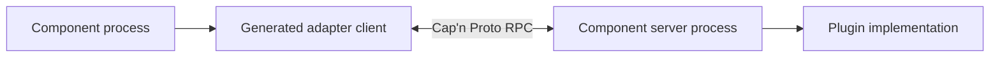

# Plugins, Plugin types and interfaces

A **[plugin type][glossary-plugin-type]** is the contract implemented by one or more [plugins][glossary-plugin]. It
defines the methods, message types, lifecycle, and adapter information needed
to instantiate and use a plugin. A **plugin** is a concrete implementation of
one plugin type. A **[component][glossary-component]** is a self-contained saved configuration of a plugin, optionally
containing concrete subcomponents. Its folder can be copied and loaded in
another workspace/runtime; see [component reuse and layout](workspaces.md).
Loading that configuration constructs a runtime instance.

At the moment, plugin types are defined with Cap'n Proto schemas. The schema is the
language-neutral source of truth for the messages and interfaces exchanged by
the plugin and its runtime adapters. RPP currently provides Python and C++
runtime support.


## Why Cap'n Proto?

Cap'n Proto was chosen because it is designed for efficient typed data exchange
without the usual serialization/deserialization step. Its representation can be
used directly in memory, which reduces conversion overhead between a [plugin][glossary-plugin]
and its runtime adapter.

It also provides two features that are important for RPP [plugin types][glossary-plugin-type]:

- **Generics** allow a reusable interface to be parameterized with the message
	types it operates on.
- **Inheritance** allows specialized plugin types to extend a common base
	interface while keeping the shared contract in one place.

For example, the controller contract below is generic over reference state,
state, enabler, and command types. `MotionController2D` specializes that
contract with concrete message types:

```capnp
using Msgs = import "rpp_common/msgs.capnp";
using Anot = import "rpp_common/anot.capnp";

interface Controller(RefState, State, Enabler, Command) {
	step @0 (ref_state :RefState, state :State, enabler :Enabler, dt :Float64)
		-> (command :Command);
}

interface MotionController2D extends(
	Controller(Msgs.Odometry2D, Msgs.Odometry2D,
						 EnablerOdometry2D, Msgs.Wrench2D)
) $Anot.plugin("MotionController2D") {}
```

The `extends(Controller(...))` declaration reuses the generic controller
contract and supplies the concrete types for this plugin type. The
`$Anot.plugin("MotionController2D")` annotation is required: it marks the
interface as an RPP plugin interface so the registrator can discover and
register it. An interface without this annotation is not treated as a
registrable RPP plugin type.

Other technologies were considered, including Protocol Buffers and gRPC.
They may be useful in future integrations, but Cap'n Proto is currently the
only supported plugin-type specification format. The design leaves room for
additional schema or interface formats later, provided they can express the
same RPP contract and integrate with the registrator and runtime adapters.

## Plugins
RPP currently supports [plugins][glossary-plugin] implemented in **C++** and **Python**. Both
languages can be used with [components][glossary-component] implemented in either language:

- A Python component can use a Python plugin or a C++ plugin.
- A C++ component can use a C++ plugin or a Python plugin.

[C++ plugin example](https://github.com/coe-marble/rpp_testing/blob/develop/rpp_testing/data/example_plugins/example_plugin_simple_cpp.cpp)

[Python plugin example](https://github.com/coe-marble/rpp_testing/blob/develop/rpp_testing/data/example_plugins/example_plugin_simple_py.py)

## Execution modes

When the [component][glossary-component] and [plugin][glossary-plugin] use the same language, the plugin is loaded
directly in the component process. The runtime imports the Python module or
loads the C++ implementation using the normal language-specific mechanism.
Construction does not configure or activate the instance; applications control
its [managed lifecycle](runtime-lifecycle.md).
From the component's point of view, it uses the plugin through its registered
[plugin-type][glossary-plugin-type] interface.

When the component and plugin use different languages, the plugin is executed
in a separate process by the appropriate component server. The component and
the plugin process communicate using Cap'n Proto RPC and the generated
interface for the plugin type:



For example, a Python component can communicate with a C++ plugin through the
C++ component server, while a C++ component can communicate with a Python
plugin through the Python component server. The process boundary allows each
runtime to load the implementation using its native language support while
the Cap'n Proto contract keeps the exchanged data and methods language-neutral.


## Local and remote execution

Today, the separate [component][glossary-component]-server process is used for cross-language
execution on the same machine. In the future, execution placement will be
configurable, allowing a component and its [plugin][glossary-plugin] to run on different
machines when required.

The component uses the same client API in both cases. It does not need to know
whether it is communicating with a local plugin instance through a local
component server or with a remote instance over a network connection. Only the
transport and deployment configuration change; the [plugin-type][glossary-plugin-type] interface and
client-facing API remain the same.

This separation makes deployment an operational choice rather than a change
to the plugin implementation. A plugin can move from an in-process or local
component-server setup to a remote machine without requiring the component to
be rewritten for a different API.


## Design rules

- [Plugin types][glossary-plugin-type] are defined inside [plugin][glossary-plugin] libraries.
- A library declares its plugin-type source files in its `plugins.json` file.
- A library declares its dependencies on other libraries in its `plugins.json` file. The registrator uses this information to generate the correct interface for each plugin type.
- The `PluginTypes` entries point to Cap'n Proto files whose annotated interfaces
  the registrator discovers and registers.
- Keep the plugin-type source path relative to the library root so the library
	can be copied or linked into another RPP home directory.

For example, the `rpp_control` library declares its controller plugin types in
`libraries/rpp_control/plugins.json`:

```json
{
	"Plugins": [
        {
			"Type": "file",
			"Path": "plugins/controllers/pid_pose_controller.hpp",
			"Name": "PIDPoseController"
		}
	],
	"PluginTypes": [
		{
			"Type": "file",
			"Path": "plugin_types/controllers.capnp"
		}
	]
}
```

The `Plugins` array declares concrete plugin implementations. The
`PluginTypes` array declares plugin-type source files. In this example,
`controllers.capnp` contains several annotated interfaces, including
`MotionController2D`, `MotionController3D`, and the corresponding allocator
types. The registrator reads the declared file, discovers each
`$Anot.plugin("...")` interface, and adds the discovered plugin types to the
library registry when the library is registered or refreshed.

## Lifecycle state and generated adapters

[Plugin][glossary-plugin] contracts can declare an owned handover state with
`$Anot.lifecycleState("Estimate")`, naming a local non-generic struct. The
registrator generates Python dataclasses and C++ native values for lifecycle
callbacks. Stateless types take no activation-state argument.

See [typed handover](runtime-lifecycle.md#typed-handover) for callback results and
support boundaries. Adapted configure/cleanup is available; adapted activation,
deactivation, and state handover remain pending. Generated clients and servers
must match their runtimes. Regenerate adapters and rebuild downstream C++ code
when upgrading the protocol or generated interface ownership rules; see
[registry compatibility](registry.md#generated-code-compatibility).

C++ code using only the native contract includes `<Type>.hpp`. Code constructing
RPC adapters explicitly includes `<Type>_Adapter_Client.hpp` or
`<Type>_Adapter_Server.hpp`. See [RPC result lifetime](component_connection.md#c-rpc-result-lifetime)
for retained views and shutdown requirements.

[glossary-plugin-type]: https://github.com/coe-marble/rpp_docs/blob/develop/docs/glossary.md#plugin-type "Plugin Type: a language-neutral contract implemented by plugins."
[glossary-plugin]: https://github.com/coe-marble/rpp_docs/blob/develop/docs/glossary.md#plugin "Plugin: a concrete implementation of a Plugin Type."
[glossary-component]: https://github.com/coe-marble/rpp_docs/blob/develop/docs/glossary.md#component "Component: a saved plugin configuration with parameters and optional subcomponents."
