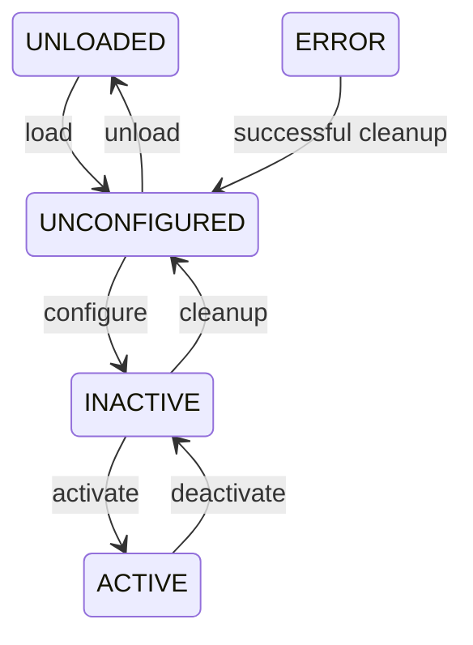

# Managed runtimes and lifecycle

Applications construct `ComponentRuntime` and `ScriptRuntime` handles through
`ComponentRuntimeBuilder`. These handles own lifecycle and slot administration.
Plugins receive `ComponentContext` for parameters, logger, clock, identity, and
subcomponent access. `SubcomponentContext` provides a restricted view of one
child's instance, identity, and activation/deactivation operations.

A component root occupies a fixed single slot. A script owns a collection of
slots and has no root plugin instance or component lifecycle state. Building
loads instances and prepares external transports; configuration and activation
are explicit. Purely native trees create no RPC executor or external process.
The application supplies its own update loop.

## Build and use a native Python component

Given a saved component folder in an RPP workspace:

```python
from rpp_py.context_builder import ComponentRuntimeBuilder

builder = ComponentRuntimeBuilder()
runtime = builder.build_component_from_path(component_path)
try:
    runtime.configure().require_success()
    runtime.activate().require_success()
    plugin = runtime.get_instance()
    # Call methods declared by the plugin's generated contract.
finally:
    runtime.close().require_success()
```

`ComponentRequest(path, plugin_name="")` is the explicit component-build input.
Scripts can be built from a path, a script-description path, or a library/script
reference. `ScriptRequest` wraps `ScriptPath`, `ScriptDescriptionPath`, or
`LibraryScript`, with optional `configuration` and `parts_folder`. The
`build_script_from_*` convenience methods accept the same overrides.

For a script, configure the collection and explicitly activate its children:

```python
runtime = builder.build_script_from_path(script_path, configuration="Default")
try:
    runtime.configure().require_success()
    runtime.get_context().activate_subcomponents().require_success()
    # Application loop uses the assigned components.
finally:
    runtime.close().require_success()
```

See the [C++ runtime](cpp-runtime.md) and [C++ construction guide](cpp-context-flow.md)
for the corresponding C++ entry points. The [tutorials](tutorials/README.md)
provide complete runnable examples.

## States, callbacks, and ownership



This diagram shows the normal path. Managers reject invalid transitions;
callback failures can leave an entry in `ERROR`. Status snapshots include the
current state, transition, last result, guarded-call count, and instance ID.
Inspect the actual result before choosing recovery.

Plugins implement `on_configure(context)`, `on_cleanup()`, `on_activate()`, and
`on_deactivate()`. Stateless callbacks return `CallbackResult`.
Configuration resolves resources and validates parameters; cleanup must handle
partial configuration. Configuration visits children before their parent.
Cleanup visits the parent before children in reverse order and continues after
independent failures.

Ordinary component activation/deactivation affects that plugin. Composite
plugins choose when to call `context.activate_subcomponents()` and
`context.deactivate_subcomponents()` in their callbacks. Script applications
call these helpers directly. Activation helpers select the exclusive candidate
or all list entries; a helper failure rolls back only entries it newly activated.
A later parent callback failure does not automatically undo a successful helper.

`deactivate()` returns `DeactivationResult`; check its `.result` and consume its
optional owned `.state`. Other lifecycle operations return `CallbackResult`;
`require_success()` raises `LifecycleError` on failure.

Explicit `close()` stops remaining active descendants, performs required cleanup,
and releases owned hosts and transports. Check its result: failed shutdown does
not grant permission to destroy an active instance. Destructor fallback is not a
replacement for deterministic closure.

## Slots and dynamic modification

| Declaration | Initial assignments | Activation |
| --- | --- | --- |
| `library::Type` | One required component | Exclusive |
| `Option[library::Type]` | Zero or more candidates | At most one active |
| `List[library::Type]` | Zero or more components | Several may be active |

Applications administer child slots with `load_component`, `configure_component`,
`activate_component`, `deactivate_component`, `cleanup_component`,
`unload_component`, `switch_component`, and `reload_component` on the runtime.
Loading produces an unconfigured entry; configure and activate it explicitly.

`allow_dynamic_components` defaults to false. Enable it on the builder with a
boolean or a callback `(slot_name, ComponentSlot) -> bool`. It is evaluated once
per locally constructed slot, including empty and nested slots. Retained build
settings govern descendants loaded later. Root component slots stay fixed.
External hosts select their own local policies; builder permissions are not
forwarded to them.

```python
builder = ComponentRuntimeBuilder(allow_dynamic_components=True)
runtime = builder.build_script_from_path(script_path)
# After configuring/activating the initial tree, a declared child slot can be
# administered through runtime.load_component(slot, name, component_path), etc.
```

Disabling dynamic modification still permits normal lifecycle and full-tree
shutdown. Switching exclusive candidates, loading, unloading, and reloading
require the affected slot's permission.

`switch_component(slot, source, target, transfer_state=True)` stops the source
and activates/selects the target. Prepare the target and check its status before
switching. `reload_component(..., transfer_state=False)` reconstructs an instance
using registered artifacts. The ROS helper does not refresh sources or compile
plugins during reload. A failed switch must be inspected; do not assume the old
source remains active or that failure rolls it back automatically.

## Typed handover

A plugin type can bind a local, non-generic state struct using
`$Anot.lifecycleState("Estimate")`. Python receives the generated dataclass;
C++ uses an owned `Estimate_Native` value through `LifecyclePlugin<State>`.
Stateful activation accepts optional state; stateful deactivation returns
`DeactivationResult<State>`. Stateless callbacks have no state argument.

Handover compatibility is checked before transfer. Separate deactivate/activate
calls do not automatically forward snapshots; the application must retain and
supply the state. Native handover is supported. Adapted activation,
deactivation, and typed handover remain unsupported; adapted configure/cleanup
and ordinary domain-method RPC are available.

## Access, identity, and guarded calls

Use `runtime.get_context()` for plugin-facing services and access to children.
Python's `get_subcomponent_context(slot, name).get_instance()` accesses a named
child; C++ uses `get_subcomponent<T>(slot, name)`. Omit the name only for the
selected single/optional entry. List slots always require a name.

A loaded instance has an opaque UUID, distinct from its saved component ID,
source path, and slot registration name. Lifecycle changes preserve it; reload
creates a new UUID. Unload clears the current ID. Old child views reject access
to released or replaced instances.

When calls may overlap transitions, use guarded access:

```python
context = runtime.get_context()
context.with_active_component("processors", "primary", lambda plugin: plugin.process(3.0))

# For a longer scope, including awaited adapter calls:
with context.active_component("processors", "primary") as plugin:
    if plugin is not None:
        result = plugin.process(3.0)
```

Python also permits selected-entry access by omitting the name in
`active_component(slot)`. C++ provides `with_active_component<T>()` and scoped
`get_active_component<T>()`. Optional `expected_instance_id` rejects a replacement
under the same registration name. Keep the runtime and guard alive for the
whole call; borrowed plugin references must not escape their guarded lifetime.
Direct pointers and references do not acquire guards: the plugin owns their
active-state checks and synchronization.

C++ defaults to `SingleThreaded`; `ConcurrentComponentRuntimeBuilder` enables
worker-thread guarded calls and call draining. Both modes require one lifecycle
owner. A deactivation timeout bounds draining guarded calls, not plugin callback
duration. Run transitions outside affected guards. See
[threading modes](cpp-runtime.md#selecting-a-threading-mode) for the C++ contract.

A plugin requests deferred self-deactivation with `context.request_deactivation()`.
The application calls `runtime.process_deactivations()` at a safe point on the
lifecycle thread. Requests coalesce; failure or timeout leaves them pending for
retry. No background lifecycle processor is created.

## Admission and parameters

Initial `registration_validators` are keyed by base plugin type and candidate
registration name. They apply to matching candidates in any slot, including
later loads. A validator receives the candidate runtime and existing runtime
snapshots, inspects metadata/parameters through `get_context()`, and returns
`CallbackResult`. Validators must not perform lifecycle operations.
`runtime.set_registration_validator(slot, validator)` adds a rule for future
admissions without revalidating existing entries.

Parameter precedence is plugin defaults, saved workspace settings, then builder
overrides. `builder.set_parameter_overrides({"library::Plugin": {"gain": 2.0}})`
replaces overrides for future builds and matching native components throughout
the tree. Undeclared names and adapted-component overrides are rejected. Input
values are copied; existing runtimes and later dynamic loads retain their captured
settings. Pass `{}` to clear overrides for future builds. Close and rebuild an
instance to read changed saved parameters.

Clock/logger options and custom external server commands belong to the builder.
`register_external_component_server(language, command)` selects a command for
future builds without launching it or changing existing runtimes.

## Upgrading older plugins

The `initialize()` API was removed. Migrate resource initialization to
`on_configure(context)` and release to `on_cleanup()`, with explicit callback
results. Application lifecycle and slot administration use runtime handles;
plugins use contexts. Regenerate interfaces and adapters and rebuild dependent
C++ code together with matching runtimes. See [registry upgrades](registry.md#upgrade-an-existing-registry)
and the [RPC response ownership rules](component_connection.md#c-rpc-result-lifetime).

Source references: [Python runtime](https://github.com/coe-marble/rpp_py/blob/develop/rpp_py/runtime.py),
[Python context](https://github.com/coe-marble/rpp_py/blob/develop/rpp_py/context.py),
[Python builder](https://github.com/coe-marble/rpp_py/blob/develop/rpp_py/context_builder.py), and
[C++ runtime](https://github.com/coe-marble/rpp_cpp/blob/develop/include/rpp_cpp/runtime.hpp).
